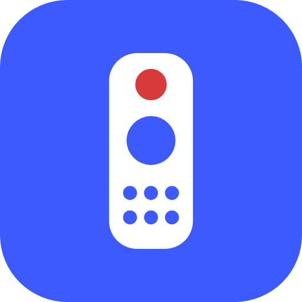
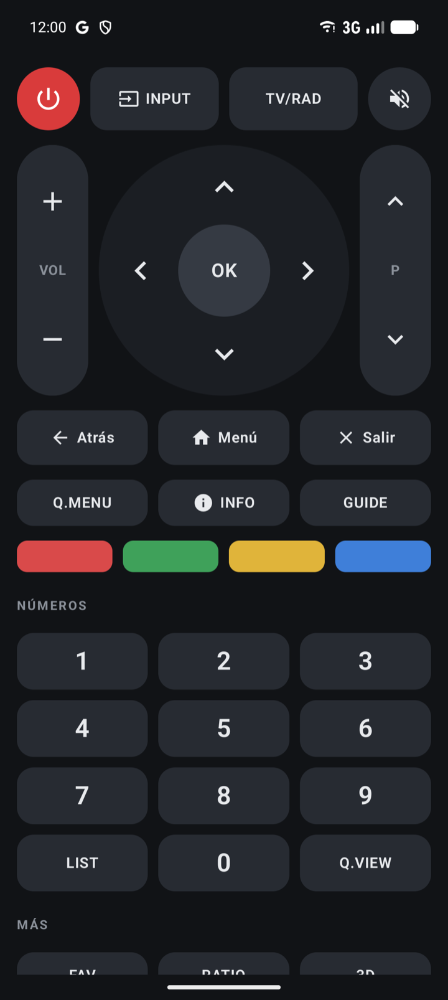
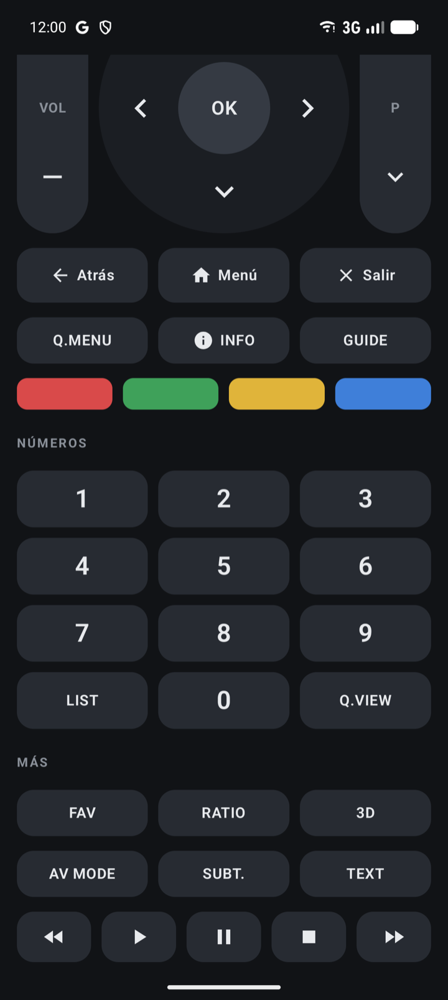

<p align="center">
  
</p>

<h1 align="center">Remoto</h1>

<p align="center">
  <b>Mando a distancia por infrarrojos para teles LG. Sin anuncios, sin internet, sin cuentas.</b><br>
  <a href="README.md">English</a> · Español
</p>

<p align="center">
  <a href="https://github.com/JonathandelaSen/remoto/releases/latest/download/Remoto.apk"><b>⬇ Descargar APK</b></a>
  &nbsp;·&nbsp; Android 8.0+ &nbsp;·&nbsp; &lt; 1 MB &nbsp;·&nbsp; GPL-3.0
</p>

<p align="center">
  
  &nbsp;
  
</p>

## Por qué

Las apps de mando para teles LG que hay en las tiendas están llenas de publicidad. Remoto hace lo mismo
con el emisor de infrarrojos del móvil, sin anuncios. No tiene permiso de internet, así que no puede
enviar nada a ningún sitio.

- **Todo el mando:** encendido, volumen, canales, cruceta, números, colores, menús y reproducción.
- **Mantén pulsado** volumen, canal o flechas y se repite, como en el mando de verdad.
- **Vibra al pulsar**, tema oscuro y pensado para usarse con una mano.
- **En 12 idiomas:** español, inglés, chino, hindi, árabe, portugués, francés, ruso, alemán, japonés,
  indonesio e italiano. Sale en el idioma del móvil, y en Android 13+ se puede cambiar solo para esta app.
  ¿Una traducción mejorable? [Abre un issue](https://github.com/JonathandelaSen/remoto/issues/new).

## Compatibilidad

### Teles

| Tele | ¿Funciona? |
|---|---|
| **LG 42LW5500** (2011–2012, Cinema 3D) | ✅ **Probada** |
| LG de antes de 2014 con mando de infrarrojos (LCD, LED y plasma; con o sin NetCast) | 🟢 Debería: usan los mismos códigos |
| LG webOS (2014 en adelante) | 🟡 Lo básico debería ir (encender, volumen, canales, cruceta, OK, números). Algún botón, como Menú, puede abrir otra pantalla distinta que en tu mando |
| Proyectores, barras de sonido y otros aparatos LG | ❌ Usan otros códigos |
| Otras marcas | ❌ Por ahora no |

¿La has probado en otra LG? [Cuéntalo en un issue](https://github.com/JonathandelaSen/remoto/issues/new)
con el modelo (está en la pegatina de atrás) y qué botones van, y se añade a la tabla.

### Móviles

Hace falta un móvil con **emisor de infrarrojos**: una ventanita oscura en el borde de arriba.
Si el tuyo no lo tiene, la app te avisa nada más abrirla. Para saberlo antes de instalar, busca tu
modelo en [GSMArena](https://www.gsmarena.com): si *Infrared port* (en *Comms*) dice **Yes**, Remoto funciona.

| Marca | ¿Tiene infrarrojos? | Por ejemplo |
|---|---|---|
| Xiaomi, Redmi y POCO | ✅ La mayoría | Xiaomi 14, Redmi Note, POCO F |
| Huawei | ✅ Casi todos los P, Pura y Mate | P30, Mate 60, Pura 70 (no con HarmonyOS NEXT, que no instala apps de Android) |
| Honor | ✅ Muchos modelos | Magic7 Pro, Honor 400 |
| OnePlus | ✅ Muchos desde mediados de 2023 | OnePlus 12, 13, 13R y 15, Nord 3 |
| Oppo | ✅ Muchos de los recientes | Find X8, Find X9, Reno 14 |
| vivo | ✅ Muchos de los recientes | X200, X300, serie T |
| Tecno e Infinix | ✅ Muchos, también los baratos | Camon 50, Spark Go 1, Hot 60, Smart 9 |
| Realme | 🟡 Algunos modelos | GT 8 Pro, serie P4 |
| Samsung | ❌ Desde 2016 no | Los últimos, Galaxy S6 y Note 4, se quedaron en Android 7 o anterior |
| Google Pixel | ❌ Nunca | |
| Motorola, Sony, Nothing | ❌ En los modelos actuales no | |
| iPhone | ❌ Nunca | Y Remoto es solo para Android |

- **Móviles antiguos con infrarrojos** (Samsung Galaxy S4–S6 y Note 3–4, LG G3–G4, HTC One M7–M9): nunca
  llegaron a Android 8.0, así que Remoto no se instala en ellos.
- **Los emisores de infrarrojos por USB-C** tampoco valen: no pasan por el sistema de infrarrojos de
  Android y cada uno funciona con su propia app.

## Instalar

1. Descarga [**Remoto.apk**](https://github.com/JonathandelaSen/remoto/releases/latest/download/Remoto.apk) desde el móvil.
2. Ábrelo. Android te pedirá permiso para instalar apps desde el navegador: acéptalo.
3. Es normal que **Play Protect** diga «Aplicación bloqueada para proteger tu dispositivo», porque no
   viene de Play Store. Pulsa **«Instalar de todas formas»**.

Las versiones nuevas se instalan igual, encima de la anterior.

## Botones

<details>
<summary>Los 46 botones y su código de infrarrojos</summary>

Todas las LG usan el protocolo **NEC** a 38 kHz con la dirección `0x04`. La columna «Código NEC» es
el formato de 32 bits de las tablas públicas de mandos (LIRC, Arduino).

| Botón | Orden | Código NEC |
|---|---|---|
| ⏻ Encender | `0x08` | `0x20DF10EF` |
| INPUT | `0x0B` | `0x20DFD02F` |
| TV/RAD | `0xF0` | `0x20DF0FF0` |
| Silencio | `0x09` | `0x20DF906F` |
| VOL + | `0x02` | `0x20DF40BF` |
| VOL − | `0x03` | `0x20DFC03F` |
| P ∧ | `0x00` | `0x20DF00FF` |
| P ∨ | `0x01` | `0x20DF807F` |
| ▲ | `0x40` | `0x20DF02FD` |
| ▼ | `0x41` | `0x20DF827D` |
| ◀ | `0x07` | `0x20DFE01F` |
| ▶ | `0x06` | `0x20DF609F` |
| OK | `0x44` | `0x20DF22DD` |
| Atrás | `0x28` | `0x20DF14EB` |
| Salir | `0x5B` | `0x20DFDA25` |
| Menú | `0x43` | `0x20DFC23D` |
| Q.MENU | `0x45` | `0x20DFA25D` |
| INFO | `0xAA` | `0x20DF55AA` |
| GUIDE | `0xAB` | `0x20DFD52A` |
| 0 | `0x10` | `0x20DF08F7` |
| 1 | `0x11` | `0x20DF8877` |
| 2 | `0x12` | `0x20DF48B7` |
| 3 | `0x13` | `0x20DFC837` |
| 4 | `0x14` | `0x20DF28D7` |
| 5 | `0x15` | `0x20DFA857` |
| 6 | `0x16` | `0x20DF6897` |
| 7 | `0x17` | `0x20DFE817` |
| 8 | `0x18` | `0x20DF18E7` |
| 9 | `0x19` | `0x20DF9867` |
| LIST | `0x53` | `0x20DFCA35` |
| Q.VIEW | `0x1A` | `0x20DF58A7` |
| Rojo | `0x72` | `0x20DF4EB1` |
| Verde | `0x71` | `0x20DF8E71` |
| Amarillo | `0x63` | `0x20DFC639` |
| Azul | `0x61` | `0x20DF8679` |
| FAV | `0x1E` | `0x20DF7887` |
| RATIO | `0x79` | `0x20DF9E61` |
| 3D | `0xDC` | `0x20DF3BC4` |
| AV MODE | `0x30` | `0x20DF0CF3` |
| SUBT. | `0x39` | `0x20DF9C63` |
| TEXT | `0x20` | `0x20DF04FB` |
| ⏪ | `0x8F` | `0x20DFF10E` |
| ▶ Reproducir | `0xB0` | `0x20DF0DF2` |
| ⏸ | `0xBA` | `0x20DF5DA2` |
| ⏹ | `0xB1` | `0x20DF8D72` |
| ⏩ | `0x8E` | `0x20DF718E` |

</details>

## Privacidad

Remoto no recoge, guarda ni envía ningún dato. No tiene permiso de internet: solo usa el emisor de
infrarrojos. Detalle en [PRIVACY.md](PRIVACY.md).

## Compilar

```sh
export JAVA_HOME="/Applications/Android Studio.app/Contents/jbr/Contents/Home"   # o cualquier JDK 17+
./gradlew testDebugUnitTest assembleRelease
# → app/build/outputs/apk/release/app-release.apk
```

Sin `keystore.properties` el APK se firma con tu clave de depuración. Funciona igual, pero no se puede
instalar encima de la versión publicada aquí.

| Dónde | Qué hay |
|---|---|
| `ir/Nec.kt` | Convierte dirección + orden en el patrón de pulsos que emite el móvil |
| `ir/LgKey.kt` | Los botones y su número de orden |
| `ir/KeySender.kt` | Cola de envío: al mantener pulsado descarta repeticiones si va atrasado, para que al soltar se pare en seco |
| `ui/` | Interfaz en Jetpack Compose |

## Licencia

[GPL-3.0](LICENSE). Puedes usarlo, cambiarlo y redistribuirlo, pero cualquier versión que publiques
tiene que seguir siendo libre y con su código abierto.
