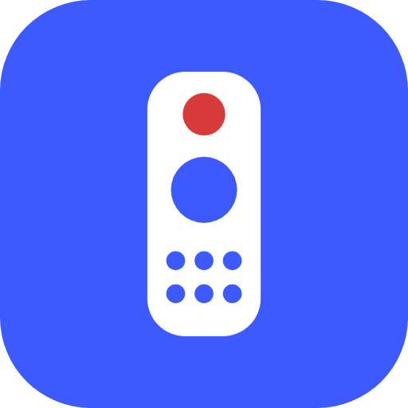
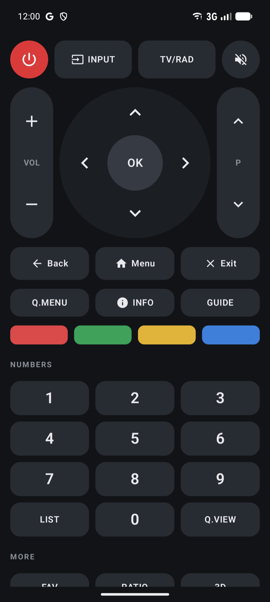
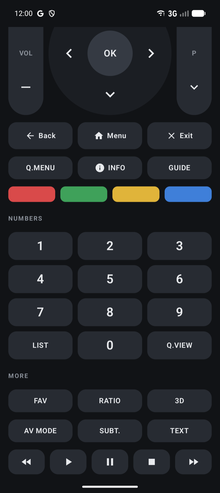

<p align="center">
  
</p>

<h1 align="center">LG Remote</h1>

<p align="center">
  <b>Infrared remote control for LG TVs. No ads, no internet, no accounts.</b><br>
  English · <a href="README.es.md">Español</a>
</p>

<p align="center">
  <a href="https://github.com/JonathandelaSen/lg-remote/releases/latest/download/LG-Remote.apk"><b>⬇ Download APK</b></a>
  &nbsp;·&nbsp; Android 8.0+ &nbsp;·&nbsp; &lt; 1 MB &nbsp;·&nbsp; GPL-3.0
</p>

<p align="center">
  
  &nbsp;
  
</p>

## Why

The remote apps for LG TVs in the stores are full of ads. LG Remote does the same job with your phone's infrared
blaster, without ads. It has no internet permission, so it can't send anything anywhere.

- **The whole remote:** power, volume, channels, d-pad, numbers, colour buttons, menus and playback.
- **Press and hold** volume, channel or the arrows and they repeat, just like the real remote.
- **Vibrates on every press**, dark theme, made for one-handed use.
- **12 languages:** English, Spanish, Chinese, Hindi, Arabic, Portuguese, French, Russian, German,
  Japanese, Indonesian and Italian. It follows your phone's language, and on Android 13+ you can pick
  another one just for this app. Spotted a clumsy translation?
  [Open an issue](https://github.com/JonathandelaSen/lg-remote/issues/new).

## Compatibility

### TVs

| TV | Works? |
|---|---|
| **LG 42LW5500** (2011–2012, Cinema 3D) | ✅ **Tested** |
| Pre-2014 LG TVs with an infrared remote (LCD, LED and plasma; with or without NetCast) | 🟢 Should work: they use the same codes |
| LG webOS (2014 onwards) | 🟡 The basics should work (power, volume, channels, d-pad, OK, numbers). Some buttons, like Menu, may open a different screen than your remote does |
| LG projectors, soundbars and other LG devices | ❌ They use other codes |
| Other brands | ❌ Not yet |

Tried it on another LG? [Tell us in an issue](https://github.com/JonathandelaSen/lg-remote/issues/new)
with the model (it's on the sticker on the back) and which buttons work, and it goes into the table.

### Phones

You need a phone with an **infrared blaster**: a small dark window on the top edge. If yours doesn't
have one, the app tells you as soon as you open it. To check before installing, look your model up on
[GSMArena](https://www.gsmarena.com): if *Infrared port* (under *Comms*) says **Yes**, LG Remote works.

| Brand | Infrared? | For example |
|---|---|---|
| Xiaomi, Redmi and POCO | ✅ Most models | Xiaomi 14, Redmi Note series, POCO F series |
| Huawei | ✅ Most P, Pura and Mate models | P30, Mate 60, Pura 70 (not with HarmonyOS NEXT, which doesn't install Android apps) |
| Honor | ✅ Many models | Magic7 Pro, Honor 400 |
| OnePlus | ✅ Many since mid-2023 | OnePlus 12, 13, 13R and 15, Nord 3 |
| Oppo | ✅ Many recent models | Find X8, Find X9, Reno 14 |
| vivo | ✅ Many recent models | X200, X300, T series |
| Tecno and Infinix | ✅ Many, even budget ones | Camon 50, Spark Go 1, Hot 60, Smart 9 |
| Realme | 🟡 Some models | GT 8 Pro, P4 series |
| Samsung | ❌ Not since 2016 | The last ones, Galaxy S6 and Note 4, stay on Android 7 or older |
| Google Pixel | ❌ Never | |
| Motorola, Sony, Nothing | ❌ Not in current models | |
| iPhone | ❌ Never | And LG Remote is Android only |

- **Older phones with infrared** (Samsung Galaxy S4–S6 and Note 3–4, LG G3–G4, HTC One M7–M9) never got
  Android 8.0, so LG Remote won't install on them.
- **USB-C infrared dongles** don't work either: they don't go through Android's infrared system, and each
  one needs its own app.

## Install

1. Download [**LG-Remote.apk**](https://github.com/JonathandelaSen/lg-remote/releases/latest/download/LG-Remote.apk) on your phone.
2. Open it. Android will ask you to allow installing apps from your browser: allow it.
3. **Play Protect** will probably say "App blocked to protect your device", because the app doesn't come
   from the Play Store. Tap **"Install anyway"**.

New versions install the same way, over the previous one.

## Buttons

<details>
<summary>All 46 buttons and their infrared codes</summary>

All LG TVs use the **NEC** protocol at 38 kHz with address `0x04`. The "NEC code" column is the 32-bit
format used in public remote tables (LIRC, Arduino).

| Button | Command | NEC code |
|---|---|---|
| ⏻ Power | `0x08` | `0x20DF10EF` |
| INPUT | `0x0B` | `0x20DFD02F` |
| TV/RAD | `0xF0` | `0x20DF0FF0` |
| Mute | `0x09` | `0x20DF906F` |
| VOL + | `0x02` | `0x20DF40BF` |
| VOL − | `0x03` | `0x20DFC03F` |
| P ∧ | `0x00` | `0x20DF00FF` |
| P ∨ | `0x01` | `0x20DF807F` |
| ▲ | `0x40` | `0x20DF02FD` |
| ▼ | `0x41` | `0x20DF827D` |
| ◀ | `0x07` | `0x20DFE01F` |
| ▶ | `0x06` | `0x20DF609F` |
| OK | `0x44` | `0x20DF22DD` |
| Back | `0x28` | `0x20DF14EB` |
| Exit | `0x5B` | `0x20DFDA25` |
| Menu | `0x43` | `0x20DFC23D` |
| Q.MENU | `0x45` | `0x20DFA25D` |
| INFO | `0xAA` | `0x20DF55AA` |
| GUIDE | `0xAB` | `0x20DFD52A` |
| 0 | `0x10` | `0x20DF08F7` |
| 1 | `0x11` | `0x20DF8877` |
| 2 | `0x12` | `0x20DF48B7` |
| 3 | `0x13` | `0x20DFC837` |
| 4 | `0x14` | `0x20DF28D7` |
| 5 | `0x15` | `0x20DFA857` |
| 6 | `0x16` | `0x20DF6897` |
| 7 | `0x17` | `0x20DFE817` |
| 8 | `0x18` | `0x20DF18E7` |
| 9 | `0x19` | `0x20DF9867` |
| LIST | `0x53` | `0x20DFCA35` |
| Q.VIEW | `0x1A` | `0x20DF58A7` |
| Red | `0x72` | `0x20DF4EB1` |
| Green | `0x71` | `0x20DF8E71` |
| Yellow | `0x63` | `0x20DFC639` |
| Blue | `0x61` | `0x20DF8679` |
| FAV | `0x1E` | `0x20DF7887` |
| RATIO | `0x79` | `0x20DF9E61` |
| 3D | `0xDC` | `0x20DF3BC4` |
| AV MODE | `0x30` | `0x20DF0CF3` |
| SUBT. | `0x39` | `0x20DF9C63` |
| TEXT | `0x20` | `0x20DF04FB` |
| ⏪ | `0x8F` | `0x20DFF10E` |
| ▶ Play | `0xB0` | `0x20DF0DF2` |
| ⏸ | `0xBA` | `0x20DF5DA2` |
| ⏹ | `0xB1` | `0x20DF8D72` |
| ⏩ | `0x8E` | `0x20DF718E` |

</details>

## Privacy

LG Remote doesn't collect, store or send any data. It has no internet permission: it only uses the
infrared blaster. Details in [PRIVACY.md](PRIVACY.md).

## Build

```sh
export JAVA_HOME="/Applications/Android Studio.app/Contents/jbr/Contents/Home"   # or any JDK 17+
./gradlew testDebugUnitTest assembleRelease
# → app/build/outputs/apk/release/app-release.apk
```

Without `keystore.properties` the APK is signed with your debug key. It works the same, but it can't be
installed over the version published here.

| Where | What's there |
|---|---|
| `ir/Nec.kt` | Turns address + command into the pulse pattern the phone emits |
| `ir/LgKey.kt` | The buttons and their command numbers |
| `ir/KeySender.kt` | Send queue: while a button is held it drops repeats if it falls behind, so it stops the moment you let go |
| `ui/` | Jetpack Compose interface |

## License

[GPL-3.0](LICENSE). You can use, change and redistribute it, but any version you publish has to stay
free and open source.

LG is a trademark of LG Electronics. LG Remote is an independent project, not made by or affiliated
with LG.
